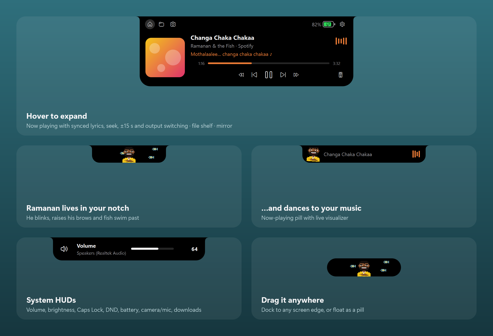

# Ramanan – Your Windows Notch Agent

A Dynamic Island–style notch for Windows 10/11, inspired by NotchNook, written in Python + PySide6.
Its pixel-art mascot is a fan tribute to Ramanan from *Punjabi House*; the project isn't affiliated with the film.



## Download

Grab `Ramanan.exe` from the [Releases](../../releases) page and double-click it. That's all: no install and no Python
needed. It runs on Windows 10 (1809+) and Windows 11, 64-bit.

The exe isn't code-signed, so the first time Windows may show **"Windows protected your PC"**. Click
**More info → Run anyway**.

## Use the app

The app has no console window and keeps running in the background. Its icon sits in the taskbar's notification
area (click the `^` arrow if Windows has tucked it away; drag it onto the taskbar to keep it visible).

- **Hover** the notch at the top of the screen to expand it. **Right-click** it for a quick menu.
- **Drag** it to any screen edge to dock it there, or drop it mid-screen to float it as a pill.
- **Tray icon:** click to open the notch, double-click for Settings, right-click for Show/Hide, Settings, Restart and Quit.
- **Start with Windows:** Settings → Behaviour. Move `Ramanan.exe` to its permanent folder *before* enabling
  this, because the startup entry remembers the exe's current path.

## Customisation (Settings window)

| Tab | Options |
|---|---|
| Appearance | Resting style (pill / slim bar / invisible), resting width, overall size (85–130 %), display, accent colour (album artwork or custom), visualizer on/off, mascot on/off |
| Behaviour | Start with Windows, position lock, hide in fullscreen apps, hover delay, HUD duration, default tab, show Mirror tab, now-playing pill, track-change announcements, synced lyrics |
| Notifications | Turn each HUD on/off: volume, brightness, Caps/Num Lock, Do Not Disturb, battery, camera/mic, downloads |

Most changes apply instantly. Only *Size* needs a restart, and there's a button for it.
Settings are stored in `HKCU\Software\WinNotch`, and the shelf and log in `~\.winnotch` (the project's original name).

## Build the exe

```powershell
powershell -ExecutionPolicy Bypass -File build.ps1    # -> dist\Ramanan.exe
python tools\make_screenshots.py                      # -> docs\preview.png
```

## Run from source

```powershell
python -m venv .venv
.venv\Scripts\pip install -r requirements.txt
.venv\Scripts\python main.py            # --demo replays every HUD, --settings opens Settings
```

## Features

| Area | What it shows | How it works |
|---|---|---|
| Now playing | Compact art + visualizer pill; expanded player with seek bar, ±15 s, prev/next | Windows global media sessions (WinRT) |
| Media extras | Synced lyrics, album-art accent colour, output-device switcher | LRCLIB API, Core Audio peak meter, `IPolicyConfig` |
| File shelf | Drop files on the notch, drag them out later | Paths stored in `~/.winnotch/shelf.json` |
| Mirror | Webcam preview; camera only on while the tab is open | QtMultimedia |
| Volume / brightness | HUD with level bar | Core Audio, `WmiMonitorBrightnessEvent` |
| Caps Lock / Num Lock | On/Off HUD | `GetKeyState` |
| Do Not Disturb | On/Off HUD | Focus Assist WNF state |
| Battery | Charging animation, unplug, full, low-battery warnings | psutil |
| Camera / mic | Green / orange dots + "in use by <app>" HUD | CapabilityAccessManager consent store |
| Downloads | Live activity with size + speed, "Download complete → Show" | Watches Downloads for `.crdownload` / `.part` |
| Fullscreen | Hides in games, videos, presentations | `SHQueryUserNotificationState` |
| Mascot | Pixel-art Ramanan who blinks, dances with real moves (bhangra, disco, wave, flex…) when music plays, and has moods: sleepy when idle, sweating on low battery, partying when a download or charge finishes, shocked when the camera turns on | Drawn in code (`notch/ui/mascot.py`) |

## License

MIT. See [LICENSE](LICENSE). Bundled libraries keep their own licenses: see
[THIRD_PARTY_NOTICES.md](THIRD_PARTY_NOTICES.md).
